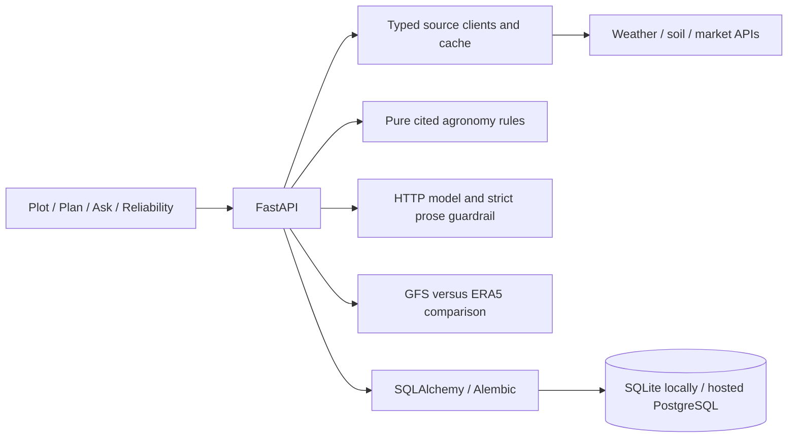

# Sowcast

Sowcast retrieves source evidence for a selected plot, computes cited crop review tasks and exposes Plot, Plan, Ask and Reliability. Rules decide actions. Missing values remain missing. This is decision support; confirm field conditions with a local extension officer.

## Quick start

Use Python 3.12 and Node 22. In an activated Python environment, run these commands from the repository root on Windows, Linux or macOS:

```sh
python -m pip install -r apps/api/requirements.lock -e "apps/api[dev]"
python -m sowcast migrate
python -m sowcast serve
```

In another terminal:

```sh
cd apps/web
npm ci
npm run dev
```

Open http://127.0.0.1:5173. The development proxy reaches the API at port 8000. No forecast key is required for Open-Meteo's free non-commercial service. The API exposes /health, database /ready, /health/sources, /docs and /openapi.json. The CLI also works after installation:

```sh
python -m sowcast --latitude 12.97 --longitude 77.59
python -m sowcast backtest --latitude 12.97 --longitude 77.59 --scheduled
```

Commands are shell-independent once the chosen environment is active. Tests/builds ran on Windows; API/web containers built and ran on Linux through Docker Desktop. The separate native Linux/macOS setup commands have not been tested outside containers.

## Environment

.env.example lists configuration names without secrets. The Python app reads the process environment, not .env automatically. Docker Compose and Vite follow their own .env behavior. Keep credentials out of frontend variables and source control.

| Variable | Meaning |
| --- | --- |
| DATABASE_URL | Shared SQLite/aiosqlite or PostgreSQL/asyncpg storage; production requires hosted PostgreSQL with explicit TLS. |
| SOWCAST_ENV | development by default; production rejects local storage and non-TLS PostgreSQL. |
| SOWCAST_TRACE_DB, SOWCAST_BACKTEST_DB | Local SQLite paths when DATABASE_URL is absent. |
| GEMINI_API_KEY, GEMINI_MODEL | Optional direct-HTTP model credentials and model name. No default model. GOOGLE_API_KEY is an accepted key alias. |
| DATA_GOV_IN_API_KEY | Optional market key; AGMARKNET_API_KEY is the legacy alias. |
| CORS_ORIGINS | Comma-separated exact permitted browser origins; empty grants none. |
| SOWCAST_RATE_LIMIT | General requests per peer IP per minute; default 120. |
| SOWCAST_AGENT_LIMIT, SOWCAST_AGENT_GLOBAL_LIMIT | Combined plan/chat requests per minute per IP and process; default 10 each. |
| SOWCAST_BACKTEST_LIMIT, SOWCAST_BACKTEST_GLOBAL_LIMIT | Backtests per minute per IP/process; default 5/10. |
| SOWCAST_UNAVAILABLE_SOURCE | Optional single source to fail through its normal error path; empty/off by default. |
| PORT | API listener, default 8000; hosting may supply it. |
| VITE_API_BASE_URL | Public API HTTPS origin at web build time; empty uses same origin. Never a credential. |
| POSTGRES_PASSWORD | Required URL-safe password for local Compose PostgreSQL. |
| TEST_DATABASE_URL | Ephemeral PostgreSQL test server with permission to create/drop test databases. Never point at production. |
| SOWCAST_API_TARGET | Development Vite proxy target, default http://127.0.0.1:8000. |
| SOWCAST_WEB_URL | Browser-check target, default http://127.0.0.1:5173. |

## Layout and request flow

apps/api contains typed source clients, shared caching, pure agronomy, model/guardrail code, backtests, API and storage migrations. apps/web contains four React views and two hand-built SVG charts. docs contains citations, contracts, operations and limits. Root Docker Compose, render.yaml and .github/workflows contain delivery configuration.



## Checks

```sh
python -m ruff check apps/api/src apps/api/tests
python -m mypy --config-file apps/api/pyproject.toml apps/api/src
python -m pytest -c apps/api/pyproject.toml apps/api/tests -q
```

From apps/web run npm run typecheck, npm run lint and npm run build. With both servers available, npm run test:browser, node tests/ask.mjs and node tests/reliability.mjs exercise real-source flows. Playwright is development-only. PostgreSQL tests skip unless TEST_DATABASE_URL is configured; final local verification explicitly included a real PostgreSQL server. See [TESTING](docs/TESTING.md) for recorded versus live inputs and results.

## Containers and deployment

Set a new URL-safe POSTGRES_PASSWORD locally, then run docker compose build and docker compose up -d --wait. Open http://127.0.0.1:8080. API/web run as non-root users; base images are pinned by digest. docker compose stop retains records. Do not remove the database volume unless you intend to erase them.

The prepared deployment uses Render Free for the API, Neon PostgreSQL for persistent records and Vercel Hobby for the web. No deployment has been performed. [RUNBOOK](docs/RUNBOOK.md) gives exact steps, environment settings, current free-plan limits, health checks, optional keep-alive and recovery. GitHub Actions definitions cover API checks with PostgreSQL and web lint/types/build; a manual live-source browser job uses the Playwright development dependency. The workflows have not run on GitHub here.

## Limitations

- SoilGrids returned nulls at target-region samples and later HTTP 503; it is optional and supplies no defaults.
- NASA POWER is a delayed retrospective cross-check, never forecast evidence. The client uses a conservative seven-day lag; values can still be null.
- Ragi and tur have no verified crop-specific water-balance rule. Other FAO values are reference estimates with the documented regional/stage limits.
- The model writes only constrained, quantity-free explanatory text; code renders values. No Gemini key/model is configured here, so successful live generation, multilingual fluency, microphone capture and spoken replies remain unverified.
- Reliability compares the GFS model with ERA5, not the live best-match blend or plot instruments. Both rain definitions show paired counts, base rates, majority baselines and approximate intervals. No lead ranking is established.
- Limits and evidence caches are process-local. Storage coordinates leases through one database. There is no user authentication; trace UUIDs do not provide access control. Hosted TLS, cold starts and persistence have not been exercised.
- Climate normals remain unavailable and the chart explains their omission. This software does not prescribe irrigation amounts or replace extension advice.

Read [AGRONOMY](docs/AGRONOMY.md), [AGENT](docs/AGENT.md), [BACKTEST](docs/BACKTEST.md), [DATA_SOURCES](docs/DATA_SOURCES.md), [API](docs/API.md), [DEMO](docs/DEMO.md) and [ROADMAP](docs/ROADMAP.md) for details.

Real local-container screenshots: [Plan](docs/images/plan.png) and [Reliability](docs/images/reliability.png). They show actual source responses from verification, not an application fallback.
