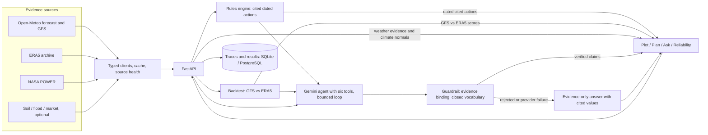
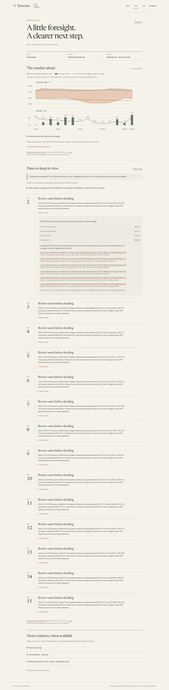
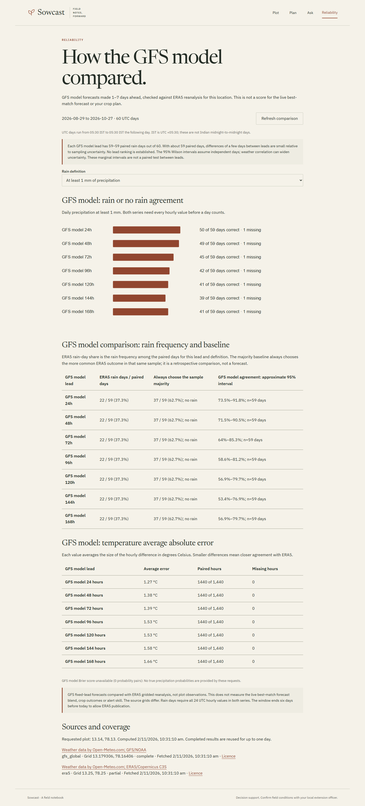

# Sowcast

[Open the live app](https://sowcast-web.onrender.com) · [API](https://sowcast-api-820y.onrender.com)

Sowcast is decision support for Kolar, Tumakuru, Chikkaballapura, Bengaluru Rural and Ramanagara. Rules decide dated crop-review tasks and calculations; the model explains the available evidence. Every evidence figure retains its source. Forecast reliability is measured by comparing GFS fixed-lead forecasts with ERA5 reanalysis at a requested location, separately from the forecast used by the plan. Confirm field conditions with a local extension officer.

- **Plot:** choose coordinates, crop and sowing status; identify the pilot district.
- **Plan:** read the dated 14-day weather evidence and conditional crop-water estimates; open **Why this task?** for inputs, rule version and citations. Fetch times are shown in section footers.
- **Ask:** request evidence-linked explanations in six answer languages and inspect or delete the execution trace.
- **Reliability:** inspect GFS-versus-ERA5 results, sample counts, uncertainty intervals and majority-class baselines.

## Quick start

Use Python **3.12** and Node **22**. Select the Python 3.12 interpreter as `python` before starting; creating an environment with Python 3.11 does not satisfy the package requirement. No forecast key is required for Open-Meteo's free non-commercial service. Set both GEMINI_API_KEY and GEMINI_MODEL in the API environment to enable model explanations; there is no default model.

```sh
git clone https://github.com/SantoshReddy0603/sowcast.git
cd sowcast
python --version
node --version
python -m venv ../sowcast-venv
```

Check that the version commands report Python 3.12 and Node 22. Activate the environment:

| Terminal | Command |
| --- | --- |
| Windows PowerShell | `& ../sowcast-venv/Scripts/Activate.ps1` |
| Linux or macOS shell | `. ../sowcast-venv/bin/activate` |

From the repository root, install the package. The metadata directory is outside the checkout; setuptools resolves egg-base from apps/api.

```sh
python -c "from pathlib import Path; Path('../sowcast-build').mkdir(exist_ok=True)"
python -B -m pip install -r apps/api/requirements.lock -e "apps/api[dev]" --config-settings=--global-option=egg_info --config-settings=--global-option=--egg-base=../../../sowcast-build
```

Create `../sowcast-local.env` with these local storage settings. If the file already exists, update these entries without replacing any credentials it contains.

```dotenv
SOWCAST_TRACE_DB=../sowcast-data/traces.sqlite3
SOWCAST_BACKTEST_DB=../sowcast-data/backtest.sqlite3
```

Add GEMINI_API_KEY and GEMINI_MODEL there only if model explanations are needed. Keep this file outside source control. In the activated environment, from the repository root:

```sh
python -B -m sowcast migrate --env-file ../sowcast-local.env
python -B -m sowcast serve --env-file ../sowcast-local.env
```

Keep that terminal running. In another terminal, from the same repository root:

```sh
cd apps/web
npm ci
npm run dev
```

Open http://127.0.0.1:5173. The development proxy reaches the API at port 8000. The API exposes /health, database /ready, /health/sources, /docs and /openapi.json. Local SQLite files and Python installation metadata stay outside the checkout; node_modules is ignored.

The Windows clean-clone check with Python 3.12 and Node 22 passed installation, migration, npm ci, API /ready and the web page.

## Environment

.env.example lists configuration names without secrets. The Python app reads the process environment by default. To load a private local file explicitly, run `python -m sowcast serve --env-file .env`. The file overrides only the environment names it declares. It accepts KEY=value lines, optional matching quotes, blank lines and full-line comments; values are literal, without interpolation or inline-comment parsing. Duplicate names and malformed entries are rejected before any file values are applied. Docker Compose and Vite follow their own .env behavior. Keep credentials out of frontend variables and source control.

| Variable | Meaning |
| --- | --- |
| DATABASE_URL | Shared SQLite/aiosqlite or PostgreSQL/asyncpg storage; production requires hosted PostgreSQL with explicit TLS. |
| SOWCAST_ENV | development by default; production rejects local storage and non-TLS PostgreSQL. |
| SOWCAST_TRACE_DB, SOWCAST_BACKTEST_DB | Local SQLite paths when DATABASE_URL is absent. |
| GEMINI_API_KEY, GEMINI_MODEL | Optional direct-HTTP model credentials and model name. No default model. GOOGLE_API_KEY is an accepted key alias. |
| DATA_GOV_IN_API_KEY | Optional market key; AGMARKNET_API_KEY is the legacy alias. |
| CORS_ORIGINS | Comma-separated exact permitted browser origins; empty grants none. |
| SOWCAST_RATE_LIMIT | General requests per peer IP per minute; default 120. |
| SOWCAST_AGENT_LIMIT, SOWCAST_AGENT_GLOBAL_LIMIT | Combined plan/chat requests per minute per IP and process; default 10 each. |
| SOWCAST_BACKTEST_LIMIT, SOWCAST_BACKTEST_GLOBAL_LIMIT | Backtests per minute per IP/process; default 5/10. |
| SOWCAST_CLIMATE_LIMIT, SOWCAST_CLIMATE_GLOBAL_LIMIT | Historical comparison requests per minute per IP/process; default 15/20, separate from backtests and agent requests. |
| SOWCAST_UNAVAILABLE_SOURCE | Optional single source to fail through its normal error path; empty/off by default. |
| PORT | API listener, default 8000; hosting may supply it. |
| VITE_API_BASE_URL | Public API HTTPS origin at web build time; empty uses same origin. Never a credential. |
| POSTGRES_PASSWORD | Required URL-safe password for local Compose PostgreSQL. |
| TEST_DATABASE_URL | Ephemeral PostgreSQL test server with permission to create/drop test databases. Never point at production. |
| SOWCAST_API_TARGET | Development Vite proxy target, default http://127.0.0.1:8000. |
| SOWCAST_WEB_URL | Browser-check target, default http://127.0.0.1:5173. |
| SOWCAST_DEMO_OUTPUT | Output directory for the optional recording script (apps/web/tests/demo.mjs); must be outside the checkout. |

## Layout and request flow

apps/api contains typed source clients, shared caching, pure agronomy, model/guardrail code, backtests, API and storage migrations. apps/web contains four React views, two hand-built SVG charts (WeatherChart.tsx, Reliability.tsx) and a Leaflet plot map (PlotMap.tsx). docs contains citations, contracts, operations and limits. Root Docker Compose, render.yaml and .github/workflows contain delivery configuration.

Only forecast evidence feeds the action rules. ERA5 supplies historical comparison and backtest reference data; NASA POWER remains a separate optional retrospective cross-check.



## Checks

```sh
python -m ruff check apps/api/src apps/api/tests
python -m mypy --config-file apps/api/pyproject.toml apps/api/src
python -m pytest -c apps/api/pyproject.toml apps/api/tests -q
```

Current results: **371 passed, 1 skipped** (the PostgreSQL case without TEST_DATABASE_URL); Ruff and mypy are clean; web lint, types and build are clean. Latest main GitHub Actions API and web jobs pass. The browser job is manual-only and was skipped. Browser test flows have also been run successfully.

From apps/web run npm run typecheck, npm run lint and npm run build. With both servers available, npm run test:browser, node tests/ask.mjs, node tests/reliability.mjs, npm run test:district, npm run test:climate and npm run test:ragi exercise real-source flows. Playwright is development-only. PostgreSQL tests skip unless TEST_DATABASE_URL is configured. See [TESTING](docs/TESTING.md) for recorded versus live inputs and results.

## Containers and deployment

Set a new URL-safe POSTGRES_PASSWORD locally, then run docker compose build and docker compose up -d --wait. Open http://127.0.0.1:8080. API/web run as non-root users; base images are pinned by digest. docker compose stop retains records. Do not remove the database volume unless you intend to erase them.

The web app is hosted on Render at https://sowcast-web.onrender.com. Its compiled API origin is https://sowcast-api-820y.onrender.com, also on Render. DATABASE_URL configures API storage; local development uses the separate SQLite paths above.

Gemini plan and chat have been tested successfully on the deployed app. Voice and browser flows have also been tested successfully. These checks do not change the language and rule scope below.

[RUNBOOK](docs/RUNBOOK.md) contains environment and operational instructions; its hosting and verification status need the corrections listed at the end of this file.

## Evidence and rules

The interface, deterministic plan reasons and citations are in English. Answers are selectable in English, Hindi, Kannada, Telugu, Tamil and Marathi (en, hi, kn, te, ta, mr). Code formats answer values using the selected script's digits and the supplied unit symbols. The model supplies quantity-free explanations from the per-language vocabulary.

The agent has six tools: get_forecast, get_soil, get_mandi_prices, run_risk_assessment, get_backtest and get_flood_signal. Forecast, flood and backtest results supply citable numeric facts. Sowing answers may use a backtest when it has been retrieved.

Paddy, maize, groundnut and tomato have conditional FAO reference crop-water estimates using the documented stage and regional context. Ragi and tur have no water-balance rule. The enabled thermal screen is paddy flowering heat above 35 C. SoilGrids and NASA POWER are optional evidence; soil values can be null, and NASA provides delayed retrospective observations.

The historical chart compares the forecast with ERA5 1991–2020 gridded calendar-day averages, rather than station normals. Reliability scores GFS against ERA5 reanalysis, separately from the plan's own best-match forecast. Its rain definitions include paired counts, base rates, majority baselines and approximate intervals.

Rate limits and evidence caches are process-local. Trace access and deletion use a per-trace capability token.

## Limits

- Reliability shown for one location and window so far
- Decision support; does not replace extension officers

Read [AGRONOMY](docs/AGRONOMY.md), [AGENT](docs/AGENT.md), [BACKTEST](docs/BACKTEST.md), [DATA_SOURCES](docs/DATA_SOURCES.md), [API](docs/API.md), [DEMO](docs/DEMO.md) and [ROADMAP](docs/ROADMAP.md) for details.

## Screenshots

Captured from the current app running locally on 2 November 2026 with real public-source responses. Scenario: Kolar, latitude 13.14, longitude 78.13; maize already growing, sowing date 1 October 2026; FAO reference estimates enabled.

### Plan

The 14-day plan shows the current forecast, ERA5 historical comparison and the first task's evidence disclosure. This local capture uses the evidence-only explanation state.



### Reliability

GFS-versus-ERA5 comparison for the same requested location, 29 August–27 October 2026, with seven forecast leads and the at-least-1-mm rain definition selected.



Application logs use structlog JSON on stderr. API records contain the server request ID, route template, method, status, source name and elapsed milliseconds. Source attempts record the source name, status or safe error code, attempt count and latency, inheriting the request ID. Raw paths, query strings, headers, bodies and provider payloads are excluded. Unhandled application errors return a fixed internal_error envelope without logging exception details. CLI evidence remains JSON on stdout. Run uvicorn with --no-access-log so its separate access logger does not print raw request targets. Logging behavior follows the context-variable guidance at https://www.structlog.org/en/stable/contextvars.html.
