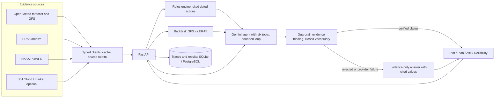

# Sowcast

Sowcast retrieves source evidence for a selected plot, computes cited crop review tasks and exposes Plot, Plan, Ask and Reliability. Rules decide actions. Missing values remain missing. This is decision support; confirm field conditions with a local extension officer.

## Quick start

Requirements: Python 3.12 and Node 22. Set both GEMINI_API_KEY and GEMINI_MODEL to enable AI explanations (plan explanations and Ask); there is no default model, and gemini-3.5-flash worked when tested on 2026-11-01. Without them the app returns the evidence-only fallback, and Plan and the evidence values still work. In an activated Python environment, run from the repository root:

```sh
python -m pip install -r apps/api/requirements.lock -e "apps/api[dev]"
python -m sowcast migrate
python -m sowcast serve
```

In another terminal:

```sh
cd apps/web
npm ci
npm run dev
```

Open http://127.0.0.1:5173. The development proxy reaches the API at port 8000. No forecast key is required for Open-Meteo's free non-commercial service. The API exposes /health, database /ready, /health/sources, /docs and /openapi.json. The CLI also works after installation:

```sh
python -m sowcast --latitude 12.97 --longitude 77.59
python -m sowcast backtest --latitude 12.97 --longitude 77.59 --scheduled
```

Commands are shell-independent once the chosen environment is active. Tests and builds are run on Windows; the API and web containers build and run on Linux through Docker. Native Linux/macOS setup outside containers is untested.

## Environment

.env.example lists configuration names without secrets. The Python app reads the process environment by default. To load a private local file explicitly, run `python -m sowcast serve --env-file .env`. The file overrides only the environment names it declares. It accepts KEY=value lines, optional matching quotes, blank lines and full-line comments; values are literal, without interpolation or inline-comment parsing. Duplicate names and malformed entries are rejected before any file values are applied. Docker Compose and Vite follow their own .env behavior. Keep credentials out of frontend variables and source control.

| Variable | Meaning |
| --- | --- |
| DATABASE_URL | Shared SQLite/aiosqlite or PostgreSQL/asyncpg storage; production requires hosted PostgreSQL with explicit TLS. |
| SOWCAST_ENV | development by default; production rejects local storage and non-TLS PostgreSQL. |
| SOWCAST_TRACE_DB, SOWCAST_BACKTEST_DB | Local SQLite paths when DATABASE_URL is absent. |
| GEMINI_API_KEY, GEMINI_MODEL | Optional direct-HTTP model credentials and model name. No default model. GOOGLE_API_KEY is an accepted key alias. |
| DATA_GOV_IN_API_KEY | Optional market key; AGMARKNET_API_KEY is the legacy alias. |
| CORS_ORIGINS | Comma-separated exact permitted browser origins; empty grants none. |
| SOWCAST_RATE_LIMIT | General requests per peer IP per minute; default 120. |
| SOWCAST_AGENT_LIMIT, SOWCAST_AGENT_GLOBAL_LIMIT | Combined plan/chat requests per minute per IP and process; default 10 each. |
| SOWCAST_BACKTEST_LIMIT, SOWCAST_BACKTEST_GLOBAL_LIMIT | Backtests per minute per IP/process; default 5/10. |
| SOWCAST_CLIMATE_LIMIT, SOWCAST_CLIMATE_GLOBAL_LIMIT | Historical comparison requests per minute per IP/process; default 15/20, separate from backtests and agent requests. |
| SOWCAST_UNAVAILABLE_SOURCE | Optional single source to fail through its normal error path; empty/off by default. |
| PORT | API listener, default 8000; hosting may supply it. |
| VITE_API_BASE_URL | Public API HTTPS origin at web build time; empty uses same origin. Never a credential. |
| POSTGRES_PASSWORD | Required URL-safe password for local Compose PostgreSQL. |
| TEST_DATABASE_URL | Ephemeral PostgreSQL test server with permission to create/drop test databases. Never point at production. |
| SOWCAST_API_TARGET | Development Vite proxy target, default http://127.0.0.1:8000. |
| SOWCAST_WEB_URL | Browser-check target, default http://127.0.0.1:5173. |
| SOWCAST_DEMO_OUTPUT | Output directory for the optional recording script (apps/web/tests/demo-output.mjs); must be outside the checkout. |

## Layout and request flow

apps/api contains typed source clients, shared caching, pure agronomy, model/guardrail code, backtests, API and storage migrations. apps/web contains four React views, two hand-built SVG charts (WeatherChart.tsx, Reliability.tsx) and a Leaflet plot map (PlotMap.tsx). docs contains citations, contracts, operations and limits. Root Docker Compose, render.yaml and .github/workflows contain delivery configuration.



## Checks

```sh
python -m ruff check apps/api/src apps/api/tests
python -m mypy --config-file apps/api/pyproject.toml apps/api/src
python -m pytest -c apps/api/pyproject.toml apps/api/tests -q
```

From apps/web run npm run typecheck, npm run lint and npm run build. With both servers available, npm run test:browser, node tests/ask.mjs, node tests/reliability.mjs, npm run test:district, npm run test:climate and npm run test:ragi exercise real-source flows. Playwright is development-only. PostgreSQL tests skip unless TEST_DATABASE_URL is configured. See [TESTING](docs/TESTING.md) for recorded versus live inputs and results.

## Containers and deployment

Set a new URL-safe POSTGRES_PASSWORD locally, then run docker compose build and docker compose up -d --wait. Open http://127.0.0.1:8080. API/web run as non-root users; base images are pinned by digest. docker compose stop retains records. Do not remove the database volume unless you intend to erase them.

The prepared deployment uses Render Free for the API, Neon PostgreSQL for persistent records and Vercel Hobby for the web. No deployment has been performed. [RUNBOOK](docs/RUNBOOK.md) gives exact steps, environment settings, current free-plan limits, health checks, optional keep-alive and recovery. GitHub Actions definitions cover API checks with PostgreSQL and web lint/types/build; a manual live-source browser job uses the Playwright development dependency. The workflows have not run on GitHub here.

## Limitations

- Key limits: rate limits and evidence caches are process-local; the historical chart baseline is ERA5 1991–2020 gridded calendar-day averages, not official station normals; the published Reliability results (docs/BACKTEST.md) come from one location (12.97, 77.59) and one 60-day window (2026-08-27 to 2026-10-25), comparing the GFS model, not the plan's best-match blend, with ERA5; each backtest covers only its own plot and 60-day window; Sowcast is decision support and does not replace local extension officers.
- Language scope: chat answers can be requested in en, hi, kn, te, ta and mr. Claim text is limited to a fixed per-language vocabulary (guardrails/prose.py), and rendered chat facts use that script's digits while unit symbols stay as supplied (apps/api/src/sowcast/i18n/render.py). The interface (docs/DESIGN.md), plan reasons, units and citations are English. Non-English output has not been reviewed by fluent readers. Voice input and spoken replies are unverified on real devices.
- SoilGrids returned nulls at target-region samples and later HTTP 503; it is optional and supplies no defaults.
- NASA POWER is a delayed retrospective cross-check, never forecast evidence. The client uses a conservative seven-day lag; values can still be null.
- Ragi and tur have no verified crop-specific water-balance rule. Other FAO values are reference estimates with the documented regional/stage limits.
- The model writes only constrained, quantity-free explanatory text; code renders values. Live Gemini generation is unverified without a configured key, model and quota; offline tests do not establish provider availability.
- Reliability does not compare plot instruments. Both rain definitions show paired counts, base rates, majority baselines and approximate intervals. No lead ranking is established.
- Storage coordinates leases through one database. There is no account authentication; trace read/delete require a per-trace capability token, and UUIDs alone grant no access. Hosted TLS, cold starts and persistence have not been exercised.
- The chart shows coverage counts and explicit missing/stale/error states. This software does not prescribe irrigation amounts.

Read [AGRONOMY](docs/AGRONOMY.md), [AGENT](docs/AGENT.md), [BACKTEST](docs/BACKTEST.md), [DATA_SOURCES](docs/DATA_SOURCES.md), [API](docs/API.md), [DEMO](docs/DEMO.md) and [ROADMAP](docs/ROADMAP.md) for details.

Real local-container screenshots: [Plan](docs/images/plan.png) and [Reliability](docs/images/reliability.png). They show actual source responses from verification, not an application fallback.

Application logs use structlog JSON on stderr. API records contain the server request ID, route template, method, status, source name and elapsed milliseconds. Source attempts record the source name, status or safe error code, attempt count and latency, inheriting the request ID. Raw paths, query strings, headers, bodies and provider payloads are excluded. Unhandled application errors return a fixed internal_error envelope without logging exception details. CLI evidence remains JSON on stdout. Run uvicorn with --no-access-log so its separate access logger does not print raw request targets. Logging behavior follows the context-variable guidance at https://www.structlog.org/en/stable/contextvars.html.
