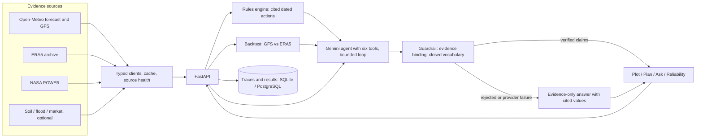

# Architecture

## Boundaries

The API uses Python 3.12, FastAPI, async httpx, Pydantic, SQLAlchemy/Alembic and SQLite/PostgreSQL async drivers. The web uses strict TypeScript, React, Vite, Leaflet, plain CSS and SVG with d3-scale/d3-shape. There is no orchestration framework, component kit or CSS framework.

| Component | Responsibility |
| --- | --- |
| sources | One typed client per external source; shared transport deadlines, retries, jitter, circuits and observed health. Clients do not call one another. |
| geography | Local simplified 2021 district boundaries resolve coordinates; provenance and uncertainty travel with the result. |
| cache | Bounded TTL/stale-while-revalidate caches, original fetch time, coalesced refresh and hard expiry. |
| agronomy | Pure formulas and cited crop catalogue. Unknown inputs return insufficient_data, never zero. |
| agent | Direct HTTP provider, one batched plan generation, bounded six-tool loop, correction and fallback. |
| guardrails / i18n | Numeric reference checks, strict quantity-free per-language prose vocabulary and code-owned value/date rendering. |
| backtest | Fixed GFS leads aligned with ERA5 by UTC valid time; paired counts, both rain definitions and retrospective baselines. |
| api | Input validation, request IDs, typed errors, rate limits, explicit CORS and health/readiness. |
| storage | SQLAlchemy models, Alembic revision 0001, bounded traces/results and owner/expiry backtest leases. |

## Data flow

## Evidence and actions

Every source envelope retains public request URL, requested and model-grid coordinates where relevant, fetch time, units, attribution, licence, data status, nulls and missing reasons. Fetch time is not model issue time. Source health describes observed attempts only; querying health does not probe upstreams. Optional soil and retrospective NASA evidence cannot fill absent forecast inputs.

POST /v1/plans validates the crop and supplied sowing/stage context, retrieves the real forecast and invokes pure run_risk_assessment. Actions retain dates, deterministic reasons, input references, rule version, computed metrics and citations. Model output can add an explanation but cannot alter the structured actions. Provider/schema/guardrail failure preserves the structured plan with a visible note. No numeric fallback data exists.

The provider makes direct httpx requests with environment key/model. Plan explanations share one structured response and one correction at most. Successful outputs have a bounded process-local cache keyed by plot, crop, language, sowing date, UTC date, rule/context/actions and numeric evidence. Chat first retrieves forecast and assessment, then permits a bounded set of additional tools. AGENT.md documents exact budgets and restrictions. A closed explanatory vocabulary rejects quantities, unknown words and unsupported characters. It limits fluency and is not a semantic proof of arbitrary sentences.

## Persistence and concurrency

DATABASE_URL selects shared storage. SQLite uses aiosqlite locally; deployed PostgreSQL uses asyncpg with TLS certificate validation. NullPool closes connections after transactions. Alembic upgrades at startup under a database migration lock before the server yields readiness. Existing local trace/job/result tables are adopted without deleting rows. Migration downgrade refuses destructive operations. SQLAlchemy models remain the schema target; schema revisions are explicit.

Trace writes redact credential-shaped content, cap payloads and retain 1,000 summaries. Backtest records retain 128 summaries; a successful summary expires after a day. Jobs use five-minute owner leases, atomic claims and owner-checked release/finish. SQLite serializes writes with immediate transactions; PostgreSQL uses transaction-scoped advisory locks. Concurrent requests in one process share shielded tasks; cross-process workers sharing the database coordinate via leases. Different databases do not coordinate. BACKTEST.md documents metrics and verification limits.

## HTTP and delivery

The outer request-ID layer wraps CORS and rate limiting so limit errors carry both required headers and the existing error body. Climate, backtest and combined plan/chat requests have separate per-IP and process-wide expensive-route budgets. Default budgets use sliding 60-second windows and bounded maps; /health and OPTIONS are exempt. /ready is a limited database probe. Peer IP is taken from the connection, not arbitrary forwarded headers. A reverse proxy may group clients under one peer; process-wide expensive-route limits still bound aggregate requests. Multi-worker limits multiply; they are not a distributed account quota.

The web uses same-origin proxies locally and a public API origin compiled into its deployment build. Explicit server CORS grants the production web origin. Render/Vercel files are configuration only; no deployment occurred. Root Compose runs pinned non-root API/web images and PostgreSQL. Render's health check and optional warm workflow request /health to avoid repeatedly waking the database. Manual pre-demo readiness checks /ready. Deployment and free-tier constraints are in RUNBOOK.md.

The failure switch is server-side configuration selecting one real typed error path; it never returns fabricated values or adds a public simulation endpoint. Restarting the API clears source caches so the switch is visible. It is empty by default.

## Verification limits

Local tests cover empty SQLite and PostgreSQL migrations, persistence, limits/CORS, sources, agronomy, guardrails and backtest behavior. Containers built and reported healthy; a proxied real-weather plan returned 14 actions. Local restart-to-readiness was measured, not remote cold start. Live Gemini generation is UNVERIFIED without credentials and quota; offline provider tests establish only the implemented boundaries. Hosted database/network behavior, physical speech, load, authorization, independent fluency review and field efficacy remain unverified.

## Historical reference and trace access

The optional climate endpoint computes ERA5 calendar-day 1991–2020 averages with sample counts, missing coverage and original fetch times. It shares the archive source transport and uses a bounded cache. The Plan overlay is a gridded historical comparison, not an official local station normal or replacement forecast.

The Plot lookup cancels obsolete requests and permits explicit manual correction. Plan and chat routes independently resolve the district before any source/model work, reject unsupported or uncertain locations and override caller-supplied district context. Trace read/delete require the response-issued capability token; only its digest is stored. Existing records without digests are inaccessible over HTTP. A capability is not account authentication.
